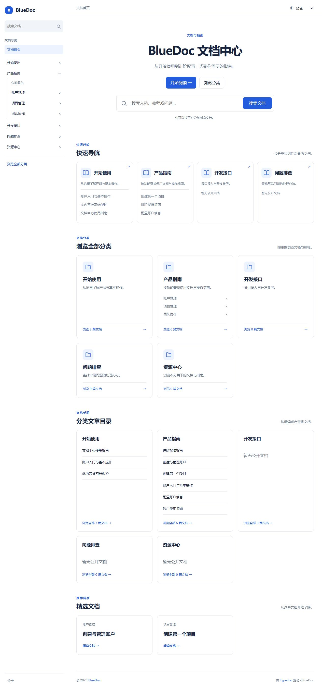
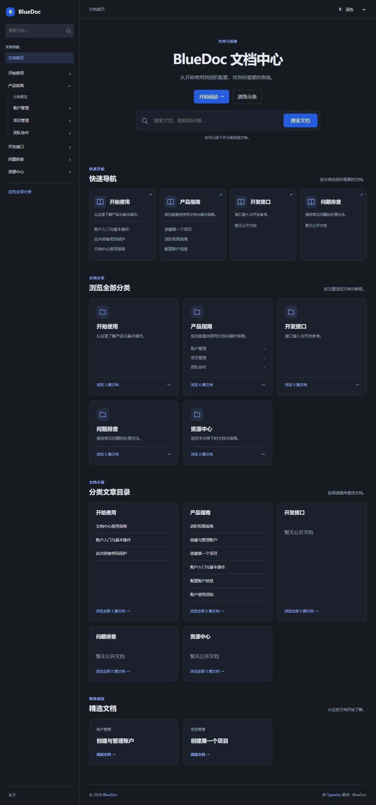

# BlueDoc V0.4 验证记录

日期：2026-10-13。隔离测试环境：官方 Typecho v1.3.0、PHP 8.2.29、SQLite、内置浏览器。没有部署到线上测试站。

## 修改文件

| 文件 | 变更 |
| --- | --- |
| theme/header.php / footer.php | 唯一全站侧栏、顶部路径、配色选择、workspace 与抽屉遮罩 |
| theme/partials/document-tree.php | 网站名称/搜索/独立页面，完整树或所属分支模式 |
| theme/partials/document-layout.php | 移除重复导航，增加同分类上下篇 |
| theme/index.php | V0.4 元信息、开始阅读入口和分类文章目录 |
| theme/category.php | 使用阅读顺序，移除重复侧栏和面包屑 |
| theme/functions.php | 新设置与原生 themePostFields 阅读序号 |
| theme/inc/navigation.php | 批量原生字段读取、稳定阅读排序和相邻文档 |
| theme/inc/home.php | 公开起始文档选择与回退 |
| theme/assets/css/style.css | 固定侧栏、简洁布局、全站配色、提示框和复制按钮 |
| theme/assets/js/color-mode.js | 绘制前应用访客/系统配色（新增） |
| theme/assets/js/main.js | 配色控制、导航记忆、全站抽屉、复制与提示框增强 |
| tests/navigation.php | 阅读排序、非法字段、相邻文档和起始文档回归 |
| tests/typecho-smoke.mjs | V0.4 首页目录与分类阅读顺序、最新入口成员归属 |
| README.md / theme/README.md | 当前功能、安装升级、文章序号与提示框用法 |
| docs/architecture.md / project.md / changelog.md | 架构与版本记录 |
| docs/v0.4-validation.md | 本次测试记录（新增） |
| demo/v0.4-home.png / v0.4-dark.png / v0.4-document.png / v0.4-mobile.png | 隔离内容的四张预览（新增） |

## 已通过

- 18 个主题 PHP 文件语法检查、68 项 PHP 逻辑回归；两份前端脚本和 HTTP 脚本语法检查。
- 12 项原生后台/HTTP 检查：主题切换启用与版本信息、完整树与分支模式、三种阅读顺序、开始阅读 CID、公开权限筛选、真实文章编辑器保存序号、非法存量值回退、搜索、独立页面、密码表单、404 和十四层分类祖先展开。
- 阅读序号测试包含零、同序号、未填序号、空值、负数、小数与过大值。多分类文章以上下篇的最深直接分类为准，不进入兄弟或父分类。
- 首页分类目录前六篇与分类完整列表排序一致；快速入口仅使用该分支最新公开文档，不被阅读序号改成手册顺序。
- 空站点仍输出搜索、全站布局与中性空状态，不生成假分类、开始阅读或上下篇；HTTP 脚本明确跳过不存在的路由。检查后恢复原始隔离数据。
- 桌面首页侧栏固定，正文没有覆盖侧栏；1280、768、375px 首页无横向溢出。
- 文章在 1280、1024、1023、768、767、375、320px 均无横向溢出。1024px 保留目录、1023px 隐藏；768px 保留侧栏、767px 切换抽屉。
- 手机抽屉打开后 workspace inert，当前文章高亮；Shift+Tab 焦点循环、Escape 关闭、展开状态更新与焦点恢复正常。
- 明暗选择在刷新后保持；跟随系统按系统偏好应用配色。深色正文、代码和提示框均使用对应背景；分类展开状态在刷新后保持。
- 真实 HyperDown 提示框生成正确，H2/H3 目录保留。代码复制点击后显示成功，实际粘贴到测试输入框的内容与代码完全一致，包括 `<script>` 与 `&` 等字符；未执行或改写代码内容。
- 最终文章浏览器 warning/error 日志为空；PHP E_ALL 日志无警告、弃用或致命错误。





## 测试方法

1. 在隔离 Typecho 1.3.0 / PHP 8.2 站点安装完整 theme 目录，后台启用 BlueDoc 0.4.0。
2. 创建任意多级分类，发布同分类多篇文档，并保留空分类、多分类文章、草稿、私密、未来与密码文档。
3. 在文章编辑器填写阅读序号 0、10、20，再留空一篇；核对侧栏、分类列表、首页目录和同分类上下篇。修改序号并保存后重新检查。
4. 在外观设置切换三种阅读顺序、完整树/分支模式，配置有效与不可公开的开始阅读 CID，核对回退逻辑。
5. 在正文添加 H2/H3、表格、代码与 `[!NOTE]`/`[!WARNING]` 引用，验证目录、复制/粘贴和提示框。
6. 检查明暗模式、刷新保持、导航开合记忆，以及 1024/1023、768/767 和手机断点。验证抽屉键盘与焦点恢复。

```sh
php tests/navigation.php
node --check theme/assets/js/main.js
node --check theme/assets/js/color-mode.js
node --check tests/typecho-smoke.mjs
node tests/typecho-smoke.mjs
```

HTTP 脚本只读，默认 `http://127.0.0.1:18230/`，可用 BLUEDOC_BASE_URL 指定其他隔离站点。

```powershell
Get-ChildItem theme -Recurse -Filter *.php | ForEach-Object { php -l $_.FullName }
php -l tests/navigation.php
```

当前不内置代码语法高亮或即时全文搜索。所有主题源代码为独立实现；测试核心、数据库、账号、CLI 工具与临时脚本未加入仓库。
